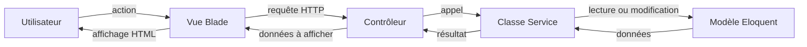
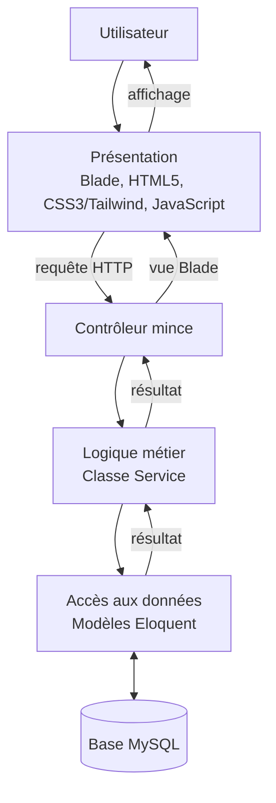
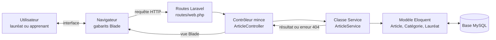

# Architecture du système

## Architecture MVC

Le modèle MVC répartit l'application en trois rôles :

- **Modèle** : représente les données et les règles qui leur sont liées (articles, catégories, comptes des lauréats).
- **Vue** : affiche les informations et reçoit les actions de l'utilisateur, au moyen des gabarits Blade.
- **Contrôleur** : reçoit une action, sollicite la logique métier et transmet le résultat à la vue.

_Figure 1 — Échange MVC : le contrôleur coordonne la vue, le service et le modèle lors d’une requête._

Dans le projet, MVC est fourni par Laravel : les routes associent une URL à un contrôleur. Le contrôleur reste **mince** : il valide l’entrée, appelle une classe Service qui porte le traitement métier, puis retourne une vue Blade ou une réponse d’erreur. Les modèles Eloquent représentent les tables MySQL et les vues Blade produisent le HTML envoyé au navigateur.

## Architecture 3-tiers

Cette architecture sépare l’application en couches qui communiquent de proche en proche :

- **Présentation** : gabarits Blade responsives (HTML5, CSS3/Tailwind, JavaScript) ; envoie les requêtes et affiche les réponses.
- **Logique métier** : contrôleurs minces et classes Service qui appliquent les règles du projet.
- **Accès aux données** : modèles Eloquent qui lisent et écrivent dans la base MySQL.

_Figure 2 — Les trois tiers séparent l’interface, le traitement des opérations et le stockage._

## Architecture globale

Le Blog des Lauréats permet à un lauréat de Solicode Tanger de rédiger, publier et administrer ses articles, et aux apprenants de consulter ces retours d’expérience. L’application est déployée en ligne et repose sur Laravel, Blade et MySQL.

_Figure 3 — Architecture globale du Blog des Lauréats._

Le parcours d’une requête est le suivant :

1. Le navigateur demande l’URL d’un article (`/articles/{slug}`).
2. La route Laravel transmet la requête à `ArticleController`, qui reste mince et délègue le travail à `ArticleService`.
3. Le service lit l’article via le modèle Eloquent, puis déclenche une erreur 404 si l’article n’existe pas ou n’est pas publié.
4. Le contrôleur transmet les données à la vue Blade, qui renvoie la page HTML consultable.
